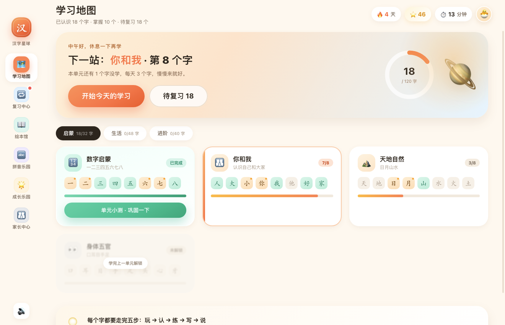
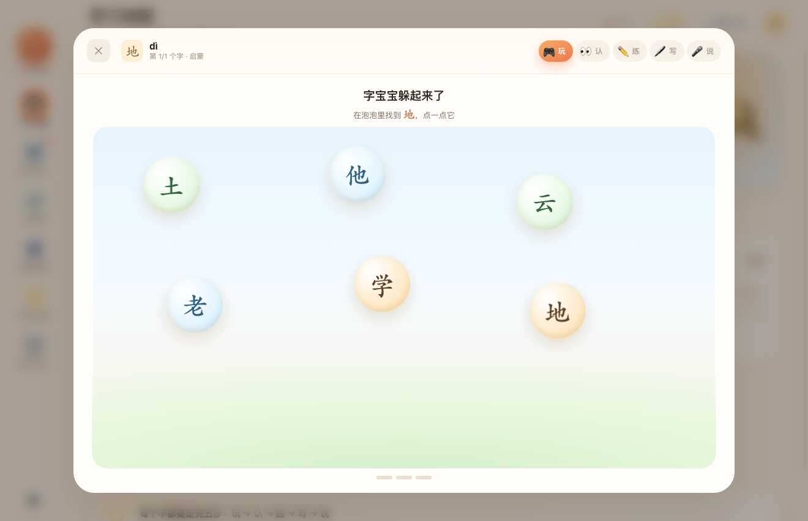
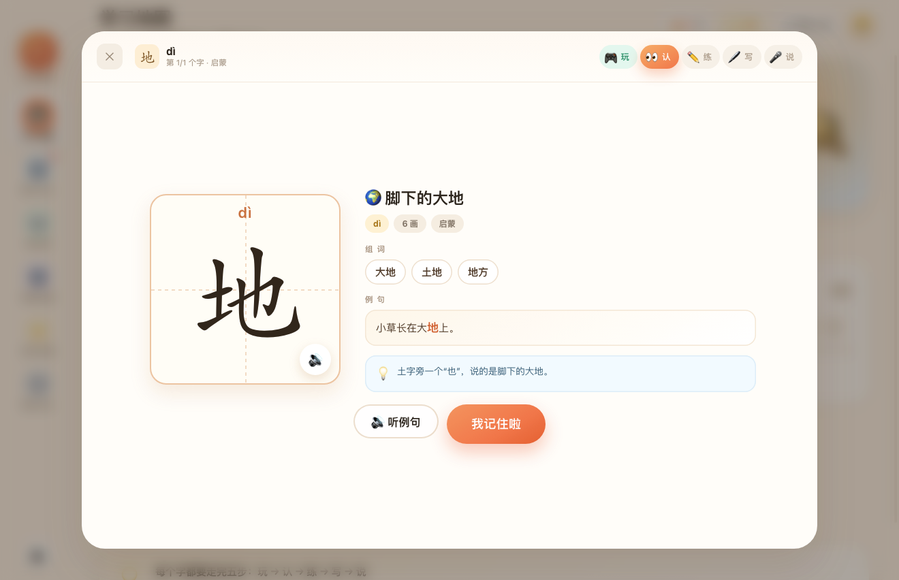
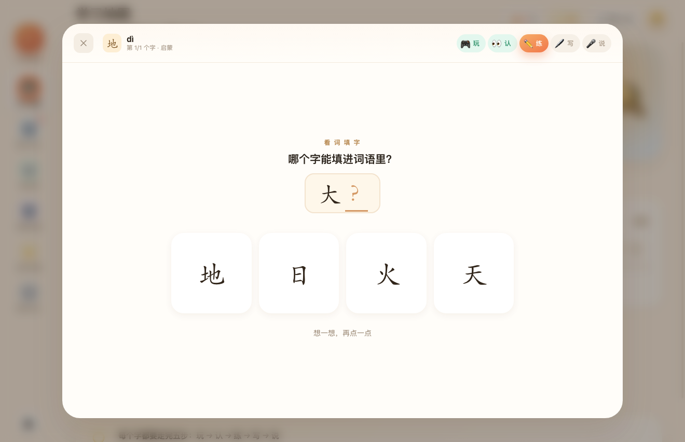
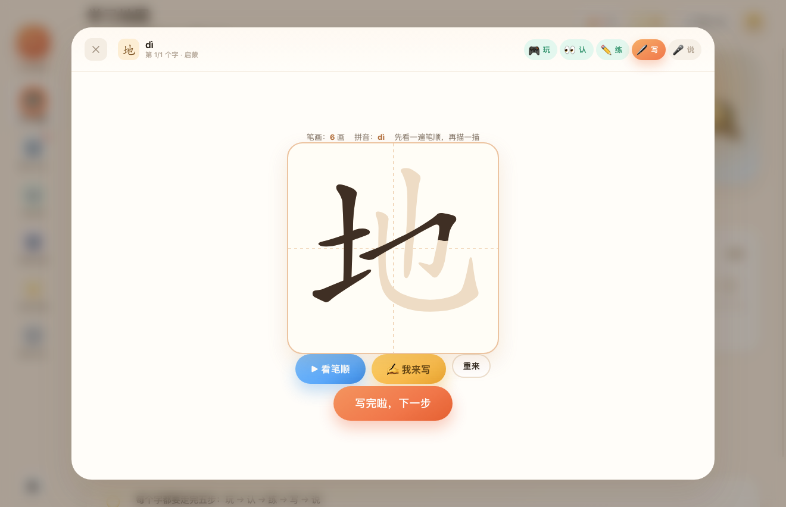
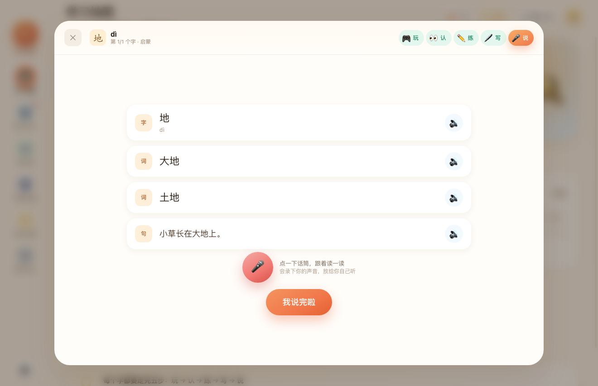
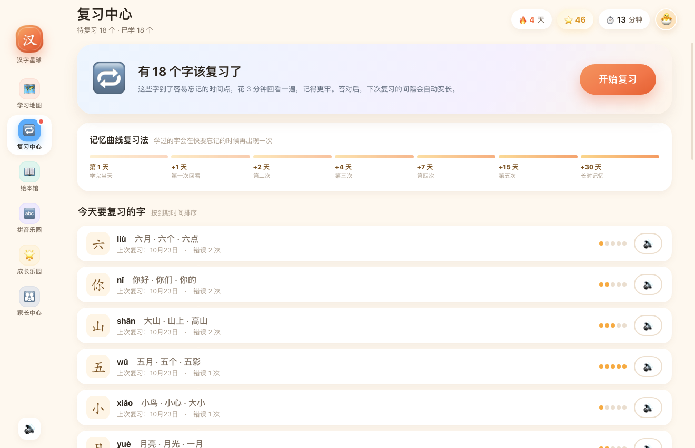
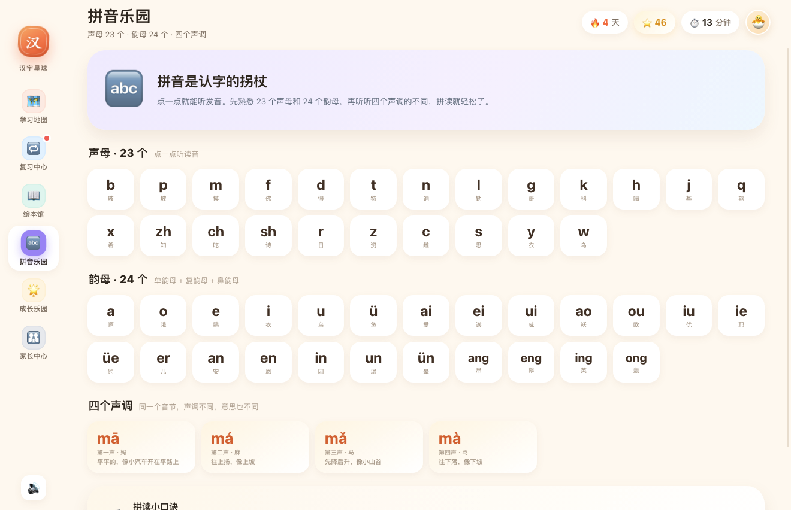
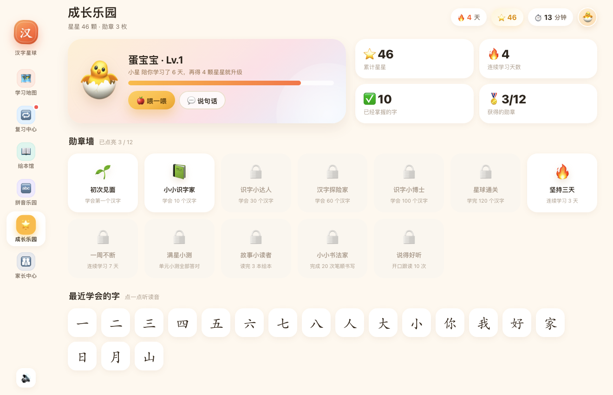
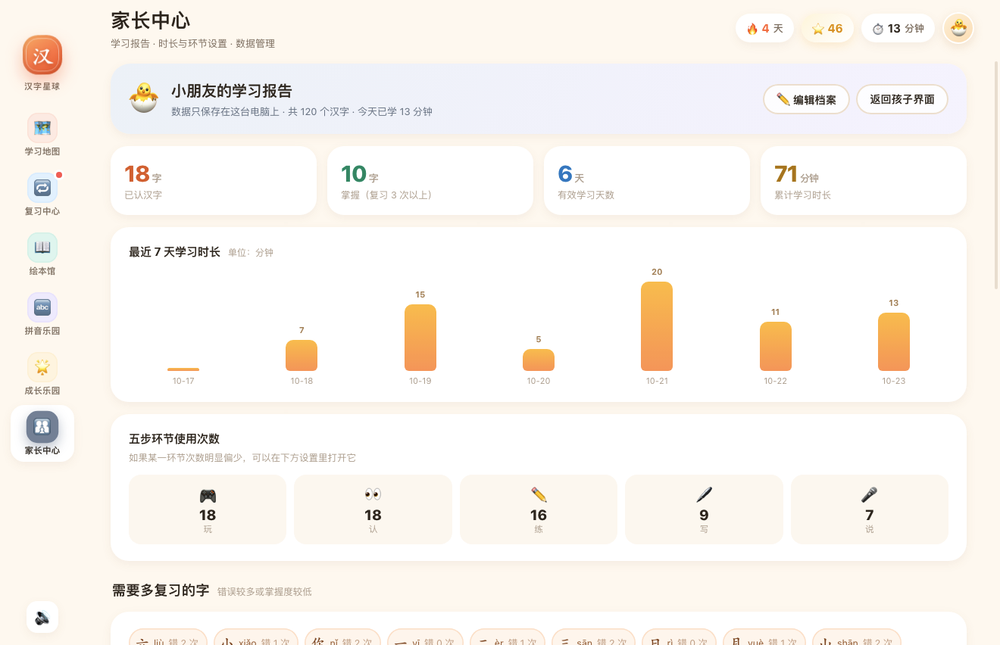

# 汉字星球 · 儿童识字学习工作台

一个照着**洪恩识字**的方法论做的桌面端识字应用：**玩 → 认 → 练 → 写 → 说** 五步闭环、地图闯关、记忆曲线复习、子集绘本、成长激励、家长中心。
纯离线，数据只存在本机，支持 **macOS** 与 **Windows**。



> 产品分析与功能拆解见 [`docs/洪恩识字功能拆解与产品设计.md`](docs/洪恩识字功能拆解与产品设计.md)

---

## 一、装哪个文件

到 [Releases](../../releases) 下载对应安装包：

| 平台 | 文件 | 说明 |
|---|---|---|
| macOS（Apple 芯片 M1/M2/M3…） | `HanziPlanet-1.0.0-arm64.dmg` | 打开 dmg，把「汉字星球」拖进 Applications |
| macOS（Intel 芯片） | `HanziPlanet-1.0.0-x64.dmg` | 同上 |
| Windows 10/11（64 位） | `HanziPlanet-1.0.0-x64.exe` | 双击安装，可自选安装目录，会创建桌面快捷方式 |

> 安装包未做代码签名（个人项目没有开发者证书），首次打开需要：
> **macOS**：右键点图标 → 打开 → 再点「打开」；或 `系统设置 → 隐私与安全性 → 仍要打开`。
> **Windows**：SmartScreen 提示时点「更多信息 → 仍要运行」。

---

## 二、孩子会看到什么

**学习地图**　15 个单元 / 120 个字 / 3 个阶段（启蒙·生活·进阶），按顺序解锁，每单元 8 个字。
**五步课程**
1. 🎮 **玩** — 字宝宝捉迷藏，在泡泡里找出目标字
2. 👀 **认** — 田字格大字、拼音、释义、组词（点读）、例句、字形小秘密、笔画数
3. ✏️ **练** — 听音选字 / 看词填字 / 看图识字，答错立刻纠正
4. 🖊️ **写** — 真实笔顺动画 + 描红 + 逐笔纠错（写错不落笔）
5. 🎤 **说** — 字 → 词 → 句阶梯朗读，录音回放自己听

**复习中心**　按 1/2/4/7/15/30/60 天记忆曲线排队；答对间隔变长，答错回到 1 天。
**绘本馆**　8 本原创子集绘本，按识字量解锁；逐字拼音、点字发音、整页朗读。
**拼音乐园**　23 声母 / 24 韵母 / 四声对比，点一点就能听。
**成长乐园**　宠物随星星升级（5 个形态）、12 枚勋章、学习统计。

## 三、家长会看到什么

- **学习报告**：已认 / 掌握 / 学习天数 / 累计时长，近 7 天时长柱状图，五环节使用次数，薄弱字清单
- **时长管理**：15 / 30 / 45 分钟或不限，到点温柔拦截
- **护眼提醒**：每 15 分钟提醒远眺
- **环节开关**：可单独关掉「写」或「说」
- **每次学习字数**：2 / 3 / 5 个
- **解锁全部单元**：不按顺序，自由选字
- **学习档案**：导出 / 导入 JSON，可换电脑迁移
- 进入家长中心需先答一道算术题（防止孩子误入）

---

## 四、开发与打包

```bash
npm install

npm start            # 本地运行
npm run shot         # 自动截图 + 全流程自测（产物在 shots/）
npm run dist:mac     # 打 macOS dmg（arm64 + x64）
npm run dist:win     # 打 Windows 安装包（nsis x64）
```

> 在 macOS 上打 Windows 包不需要 Wine（electron-builder 自带跨平台 NSIS）。
> 如果构建环境注入了 `NODE_OPTIONS` 之类的 require hook，用 `env -u NODE_OPTIONS` 再执行。

### 目录结构

```
electron/
  main.js            窗口 / 菜单 / 数据读写 IPC / 麦克风权限
  preload.js         contextBridge 暴露最小 API
src/
  index.html
  css/base.css       设计系统：色板、阴影、圆角、动效
  css/views.css      六个页面 + 五步课程样式
  js/data.js         120 字 / 15 单元 / 8 绘本 / 12 勋章 / 拼音表
  js/store.js        状态、持久化、掌握度与复习算法
  js/sfx.js          Web Audio 合成音效 + 系统 TTS
  js/ui.js           DOM 工具 / Toast / 彩带 / Modal
  js/views/          map · lesson · review · read · pinyin · grow · parent
  data/strokes.js    120 字笔顺数据（构建期从 hanzi-writer-data 合并）
  data/book-pinyin.js 绘本逐字拼音（构建期用 pinyin-pro 生成）
  vendor/hanzi-writer.min.js
tools/
  shot.js            自动截图 / 流程自测
  make_icon.py       生成 1024×1024 应用图标
docs/
  洪恩识字功能拆解与产品设计.md
```

### 数据存在哪

- macOS：`~/Library/Application Support/汉字星球/hanzi-planet-data.json`
- Windows：`%APPDATA%\汉字星球\hanzi-planet-data.json`

写入采用「临时文件 + rename」的原子方式，异常退出不会写坏档案。卸载应用不会删除学习记录（可在家长中心手动重置）。

---

## 五、想加字 / 改内容

字库是纯数据，在 `src/js/data.js` 里一行一个字：

```
字|拼音|释义|组词1,组词2,组词3|例句|字形小秘密|图标emoji
```

新增字之后，需要重新生成笔顺与绘本拼音（可选）：

```bash
node tools/build-content.js    # 复制笔顺数据 + 生成绘本拼音
```

（脚本会读取 `data.js` 中的字表，把 `hanzi-writer-data` 里对应的笔顺合并进 `src/data/strokes.js`。）

---

## 六、已知限制

- **朗读**依赖系统中文语音。macOS 一般自带「婷婷」，Windows 自带「慧慧」；若系统未安装中文语音，可在系统设置里添加（Windows：设置 → 时间和语言 → 语音 → 添加语音）。
- **跟读录音**需要麦克风权限，拒绝后仍可继续（只是听不到自己的声音）。
- 未签名安装包首次运行需要手动放行，见上文。
- 字库目前 120 字（覆盖启蒙与生活常用），扩展方式见第五节。

---

## 七、截图

| 五步课程 | |
|---|---|
|  |  |
| **玩**：字宝宝捉迷藏 | **认**：田字格 + 组词 + 例句 |
|  |  |
| **练**：看词填字 | **写**：笔顺动画 + 描红纠错 |
|  |  |
| **说**：字→词→句跟读 | 学会一个字：+3 星 |

| 其他页面 | |
|---|---|
|  |  |
| 复习中心：记忆曲线队列 | 绘本馆：按识字量解锁 |
|  |  |
| 绘本阅读：逐字拼音、点字发音 | 拼音乐园 |
|  |  |
| 成长乐园：宠物与勋章 | 家长中心：学习报告 |

---

## 八、致谢

- 笔顺数据：[hanzi-writer](https://github.com/chanind/hanzi-writer) / hanzi-writer-data
- 拼音：[pinyin-pro](https://github.com/zh-lx/pinyin-pro)
- 方法论参考：洪恩识字（本项目的**独立实现**，与其无任何关联）

MIT License
